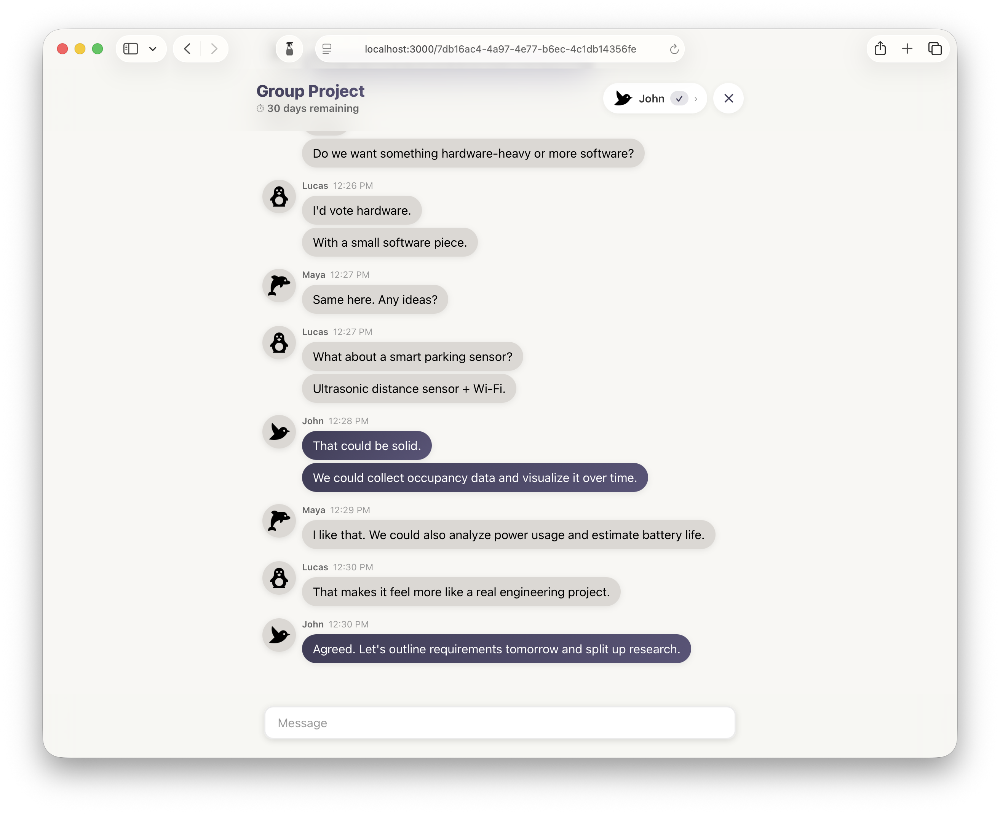
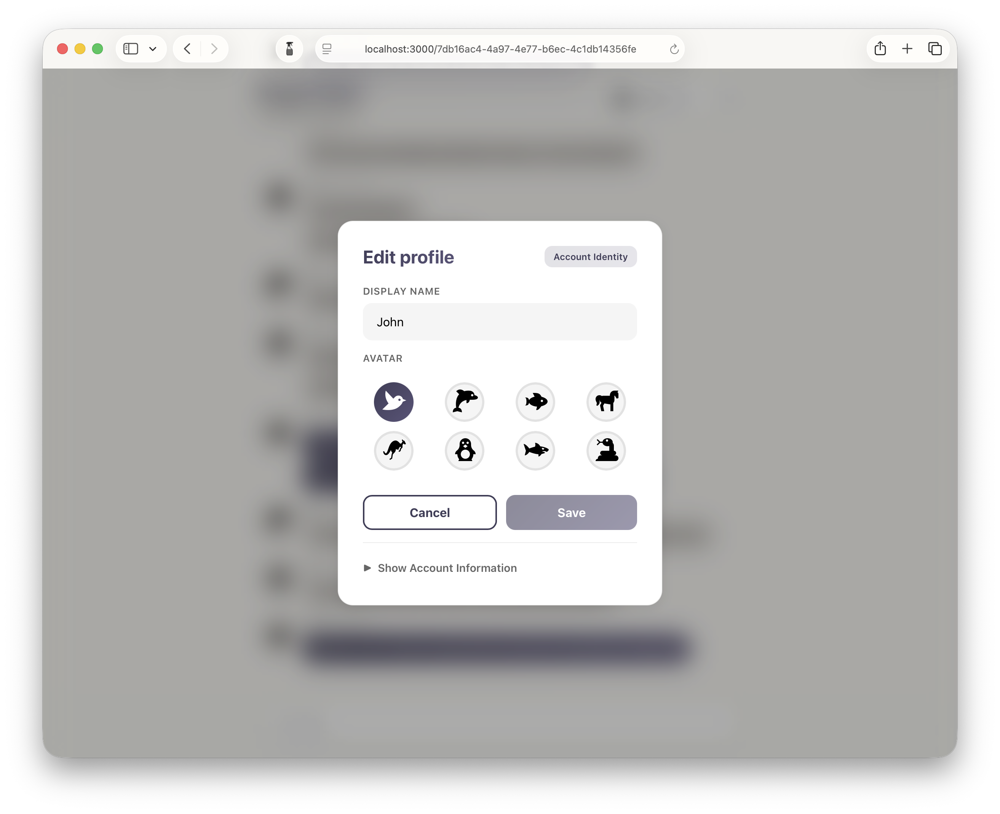
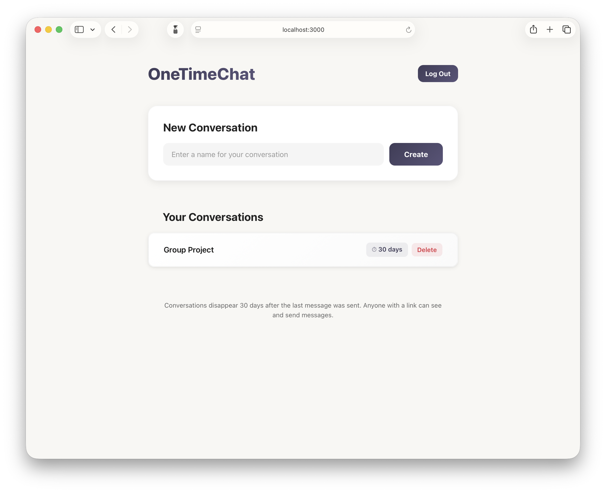
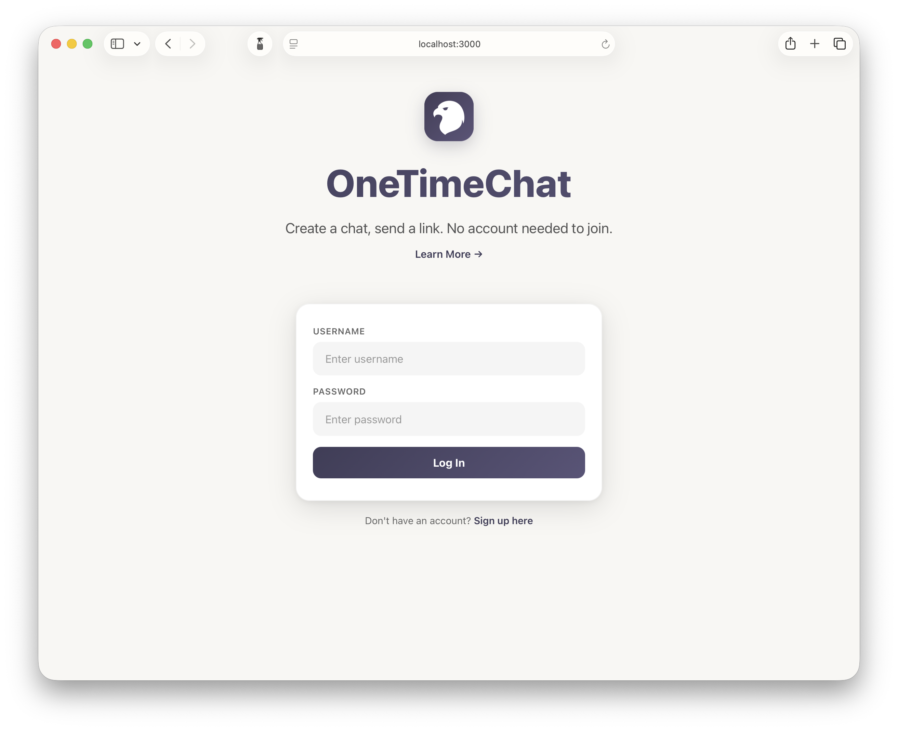

# Web Messages


<details>
    <summary><strong>More Screenshots</strong></summary>
  
  
  

</details>

Web Messages is a link-based group messaging app: anyone with a conversation's link can join under a display name, no account required, and conversations are deleted after 30 days of inactivity.

This repository only gets the two apps running together for local development, with hot reload:

- **[web-messages-service](https://github.com/appdevjohn/web-messages-service)**: Express and Socket.IO backend, storing data in SQLite
- **[web-messages-pwa](https://github.com/appdevjohn/web-messages-pwa)**: React progressive web app built with Vite

There is no database server. The service creates its SQLite database at `web-messages-service/data/messages.db` the first time it starts.

## Prerequisites

- [Docker](https://docs.docker.com/get-docker/) with Docker Compose
- Make and Git

## Quick Start

```bash
git clone https://github.com/appdevjohn/web-messages
cd web-messages
make setup   # clones both apps into this directory
make start
```

The first start runs `npm install` in each container, so give it a minute (`make logs` shows progress). Then open:

- **PWA**: http://localhost:3000
- **Service**: http://localhost:8000 (`/health-check` to confirm it's up)

Edit code in `web-messages-service/src/` or `web-messages-pwa/src/`: the service restarts through nodemon and the PWA updates through Vite HMR.

## Commands

| Command        | Description                                           |
| -------------- | ----------------------------------------------------- |
| `make setup`   | Clone both apps (skips any already present)           |
| `make start`   | Start the service and PWA                             |
| `make stop`    | Stop both                                             |
| `make restart` | Restart both (also reinstalls changed dependencies)   |
| `make logs`    | Follow logs from both                                 |
| `make pull`    | Pull the latest changes in both apps                  |
| `make clean`   | Stop both and delete their `node_modules` volumes     |

## Configuration

Everything has a working default, so no `.env` file is needed to get started. To change something, copy the example file and edit it:

```bash
cp .env.example .env
```

| Variable                                                   | Default                    | Purpose                                                                         |
| ---------------------------------------------------------- | -------------------------- | ------------------------------------------------------------------------------- |
| `SERVICE_PORT` / `PWA_PORT`                                | `8000` / `3000`            | Ports on your machine                                                           |
| `APP_NAME`                                                 | `OneTimeChat`              | Name shown in the PWA and in emails                                             |
| `TOKEN_SECRET`                                             | `local-development-secret` | JWT signing secret                                                              |
| `VERIFY_USERS`, `SEND_EMAILS`                              | `false`                    | Email verification and sending                                                  |
| `MAILJET_API_KEY`, `MAILJET_API_SECRET`                    |                            | Required when `SEND_EMAILS=true`                                                |
| `ENABLE_UPLOADS`                                           | `false`                    | Image messages                                                                  |
| `VAPID_PUBLIC_KEY`, `VAPID_PRIVATE_KEY`, `VAPID_SUBJECT`   |                            | Push notifications, enabled when all three are set                              |
| `OLLAMA_HOST`                                              |                            | AI responses, enabled when set (e.g. `http://host.docker.internal:11434`)       |
| `NODE_ENV`                                                 | `test`                     | `test` logs verification and password-reset codes to the service logs           |

Generate VAPID keys with `npx web-push generate-vapid-keys`. Push works over `localhost` without HTTPS.

Run `make restart` after changing `.env`.

## How It Fits Together

Both containers run the `node:24-alpine` image directly with the app's directory bind-mounted, so there are no images to build. Dependencies live in a named volume per app and are reinstalled on every start, which picks up `package.json` changes automatically.

The browser only talks to the PWA. Its Vite dev server proxies `/auth`, `/push`, and `/socket.io` to the service at `http://service:8000`, so the PWA needs no backend URL configured.

Data written by the service stays in its directory on your machine: the database in `web-messages-service/data/` and uploaded images in `web-messages-service/uploads/`. To start over with an empty database, stop everything and delete `web-messages-service/data/`.

## Troubleshooting

**A port is already in use.** Set `SERVICE_PORT` or `PWA_PORT` in `.env`, or find what's using it with `lsof -i :3000`.

**The PWA can't reach the service.** Check `docker compose logs service` for startup errors and `docker compose logs pwa` for proxy errors, then confirm the service responds with `curl http://localhost:8000/health-check`.

**Dependencies seem stale or broken.** Run `make clean` and `make start` to reinstall them from scratch.

## Contributing

Issues and changes for each app belong in its own repository:

- [web-messages-service](https://github.com/appdevjohn/web-messages-service/issues)
- [web-messages-pwa](https://github.com/appdevjohn/web-messages-pwa/issues)

Issues with this development setup belong here.
